  

  
  &nbsp;
  
  &nbsp;
  

---

### About

I'm Francisco, a Computer Engineering student at UBI (halfway through the degree), originally from Águeda, Aveiro. Curious about how things are built, with a growing focus on Quantitative Finance — combining code with markets, data and models.

### Tools & Languages

Python · C · C++ · R · SQL (MySQL / PostgreSQL) · Linux · Docker · Git · LaTeX

### Next

Exploring Data Science and Machine Learning applied to Finance.

---

  <a href="https://www.linkedin.com/in/-francisco-branco-2005-/">LinkedIn</a>

